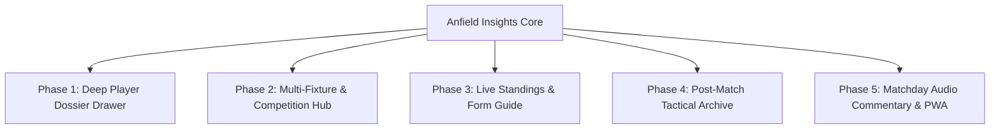

# Product Requirements Document (PRD) — Anfield Insights Roadmap

**Project Name:** Anfield Insights  
**Document Status:** Approved for Implementation  
**Version:** 1.0.0  
**Target Audience:** Liverpool FC supporters, tactical analysts, football researchers  
**Design Language:** Apple Dark Glass / British English (`en-GB`)  

---

## 1. Executive Summary & Vision

Anfield Insights is a premier, ad-free matchday intelligence and tactical telemetry platform. While our initial foundation delivers live scoreboards, matchday schedule simulations, and DeepMind TacticAI set-piece analysis, this PRD outlines the **Next High-Impact Steps** required to transform the product into a definitive football intelligence suite.

---

## 2. Core Epics & Feature Specifications

### Epic 1: Interactive Player Dossier Drawer (P1)
- **Objective:** Provide granular tactical breakdowns when clicking any player node on the pitch canvas or squad list.
- **Requirements:**
  - Slide-over glass sheet from the right viewport or bottom sheet on mobile.
  - Per-90 tactical radar (Progressive Carries, Pressing Actions, xG/xA, Ground Duels Won %, Pass Completion under High Press).
  - Physical match status: Minutes played, fatigue index, discipline (yellow/red cards), current heat quadrant.
  - Tactical assignment note based on manager's formation (e.g. Inverted Wingback under Arne Slot, Box Midfield anchor).

### Epic 2: Multi-Fixture & Competition Hub (P1)
- **Objective:** Allow fans to seamlessly pivot between the upcoming match, live fixtures, and future domestic/European clashes.
- **Requirements:**
  - Sticky sub-navigation pill strip: Premier League, UEFA Champions League, FA Cup, Carabao Cup.
  - Compact horizontal fixture ribbon displaying countdowns, opponent form, and broadcast channels (Sky Sports, TNT Sports, Amazon Prime).
  - Automatic active fixture auto-selection based on real current date/time.

### Epic 3: Live Premier League Standings & Form Guide (P2)
- **Objective:** Display an uncluttered, high-contrast league table reflecting live in-play score recalculations.
- **Requirements:**
  - Visual European qualification zones (UCL Top 4, UEL, Conference League, Relegation).
  - Dynamic points, goal difference (GD), and current match impact (+3 / +1 / 0 points badge).
  - Last 5 matches form indicators with expandable match score popovers.

### Epic 4: Post-Match Tactical Breakdown & xG Shot Map (P2)
- **Objective:** Enable fans to replay and inspect finished matches with analytical precision.
- **Requirements:**
  - Full xG shot map with bubble size reflecting shot probability and goal highlights.
  - Complete pass network matrix showing average player positions and passing frequency thickness.
  - Manager post-match tactical rating and key referee incidents timeline.

### Epic 5: Live Matchday Audio & PWA Offline Cache (P3)
- **Objective:** Keep supporters connected on matchdays, whether in transit, at home, or inside Anfield.
- **Requirements:**
  - Ambient, non-intrusive audio player bar connecting to official live audio commentary feeds.
  - Progressive Web App (PWA) manifest and service worker caching core assets for patchy stadium connectivity.

---

## 3. Engineering & UX Guidelines
1. **Language Standard:** Strict British English (`en-GB`) across all labels, dialogues, summaries, and tooltips (*colour*, *customise*, *optimise*, *centre*, *defence*).
2. **Data Integrity:** Only real data from authorized public sports APIs and satellite feeds (ESPN, Open-Meteo). No placeholder or mocked figures in production feeds.
3. **Trademark Security:** No copyrighted commercial logos; preserve custom SVG vector crests and typography.
4. **Performance:** Under 100ms UI interaction latencies; 60fps animations using Tailwind CSS and CSS transitions.

---

## 4. Master Implementation Checklist

### Phase 1: Player Dossier Drawer
- [ ] Create `src/components/insights/PlayerDossierDrawer.js` component with Apple glass styling.
- [ ] Connect pitch canvas node click handler to populate selected player state.
- [ ] Implement SVG per-90 radar chart for key metrics (Pressing, Carrying, Passing, Defending).
- [ ] Add player role descriptions (e.g., Inverted Fullback, False 9, Box-to-Box).
- [ ] Add smooth keyboard accessibility (`Escape` to close, `Tab` cycling).

### Phase 2: Multi-Fixture & Competition Selector
- [ ] Create `src/components/insights/FixtureSelector.js` ribbon component.
- [ ] Support filter tabs: `All`, `Premier League`, `Champions League`, `Domestic Cups`.
- [ ] Bind fixture selection to update the active match telemetry and tactical pitch.
- [ ] Add TV broadcast badges (UK broadcasters: Sky Sports, TNT Sports, BBC).

### Phase 3: Live Standings & Form Guide
- [ ] Create `src/components/insights/StandingsTable.js` with live recalculation logic.
- [ ] Add color-coded qualification indicators (Champions League blue, Europa League orange, Relegation red).
- [ ] Implement 5-game form pill indicators (`W`, `D`, `L`) with score tooltips.
- [ ] Add collapsed-by-default view toggle to avoid displacing the primary match HUD.

### Phase 4: Post-Match Analytics & Shot Map
- [ ] Create `src/components/insights/PostMatchShotMap.js` utilizing SVG coordinates.
- [ ] Display shot outcomes: Goal, Saved, Blocked, Off Target with xG bubble sizes.
- [ ] Build pass network connection lines with dynamic thickness based on successful passes.

### Phase 5: Live Audio & Offline Support
- [ ] Implement `src/components/insights/AudioCommentaryBar.js` with play/pause and volume slider.
- [ ] Configure `public/manifest.json` with Anfield Insights app icons and PWA settings.
- [ ] Verify Lighthouse Accessibility and Performance scores $\ge 95$.
